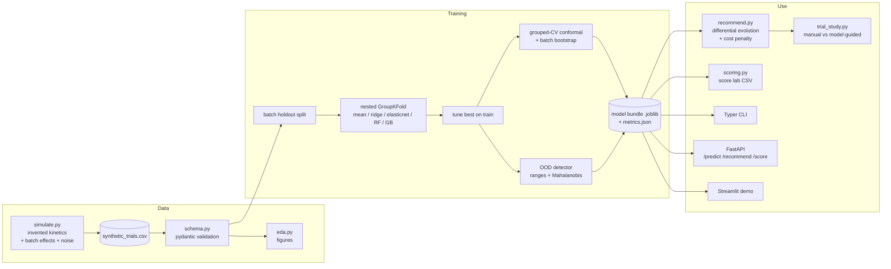
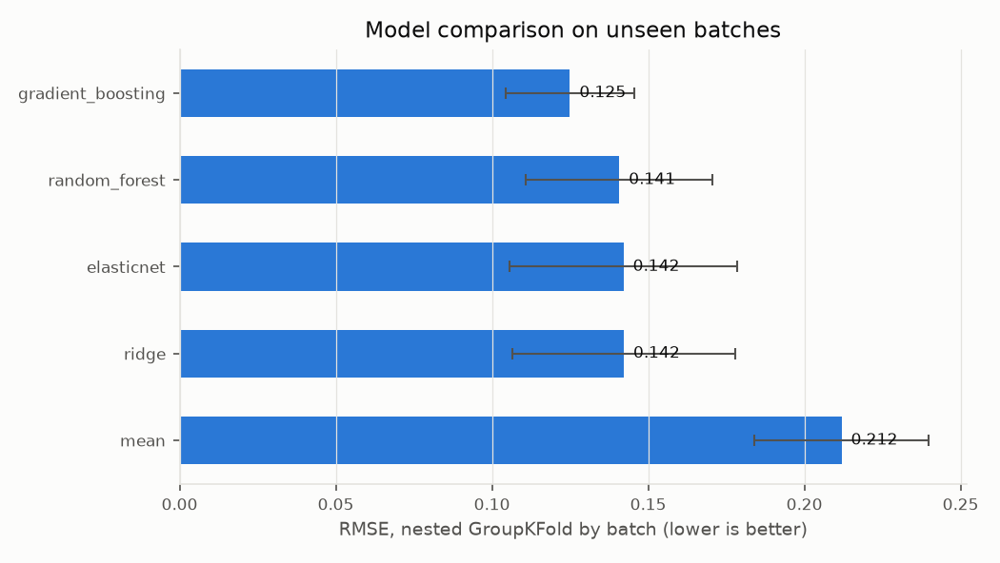
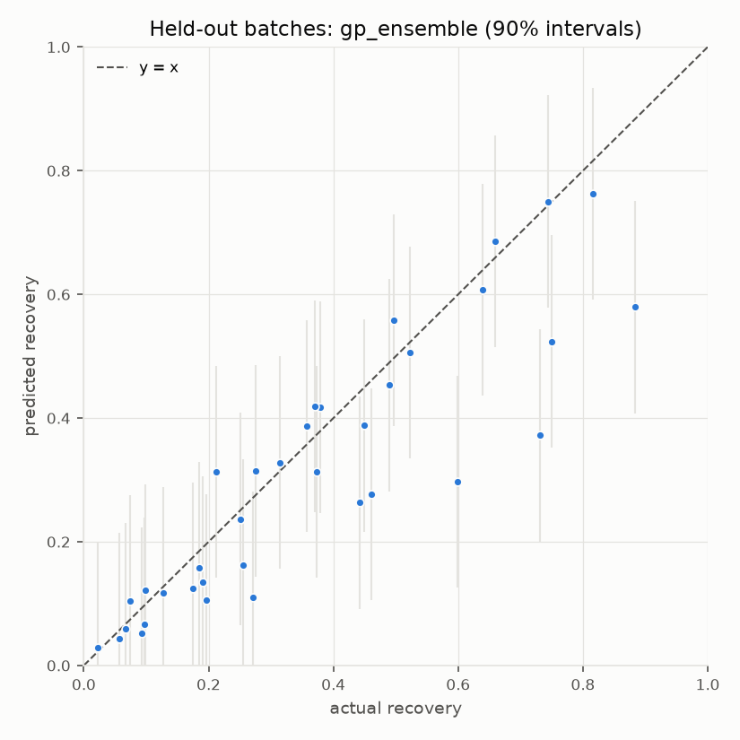
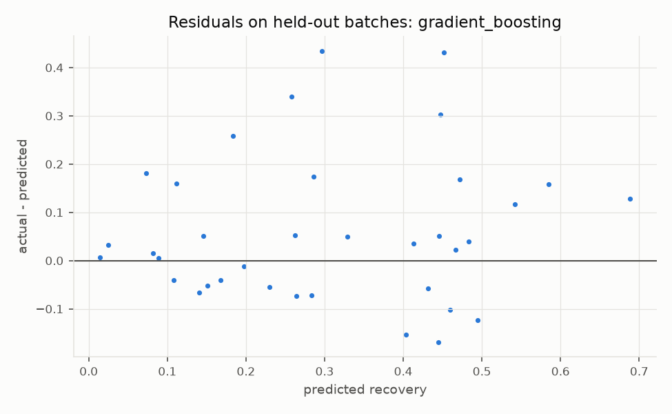
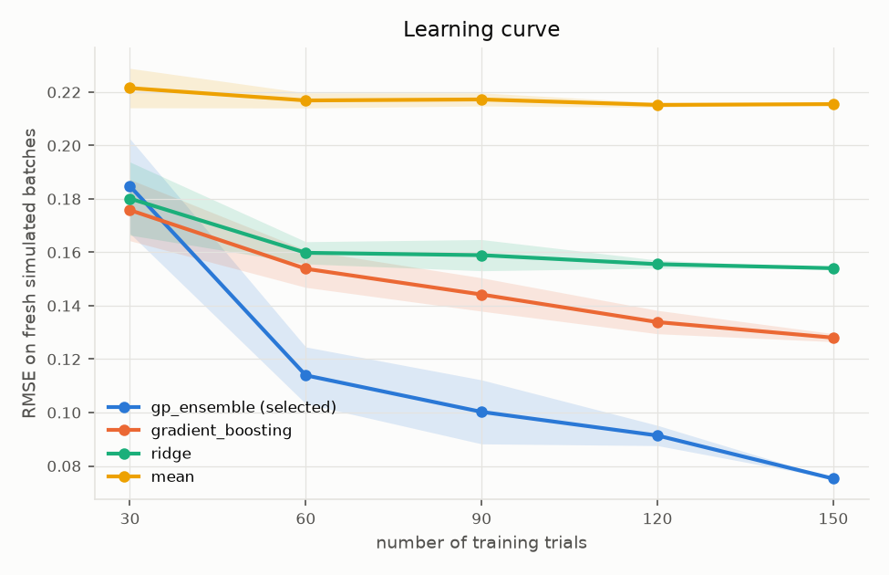
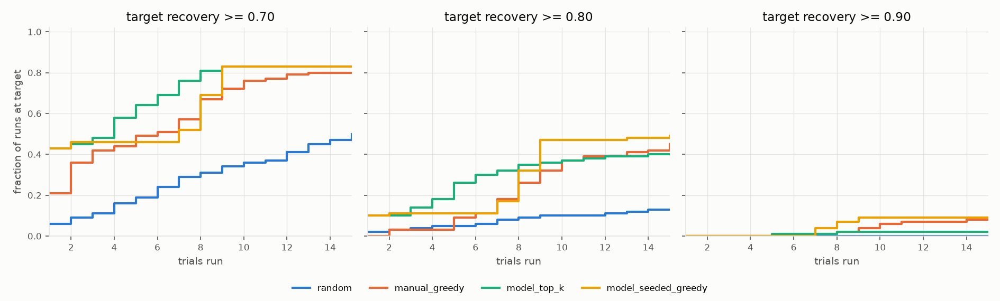

# leach-recipe-predictor

> [!IMPORTANT]
> **Synthetic data; demonstrates the methodology only; unrelated to any proprietary work.**
> Every number in this repository comes from a small simulator I invented
> ([`src/leach/simulate.py`](src/leach/simulate.py)). The simulator is not representative of any
> real chemistry, reagent system, ore or process, and no result here should be read as matching
> any real process or any employer's work. It contains no proprietary data, formulas, reagent
> names, ratios or code.

## Problem

In a leaching process, a **recipe** (reagent and oxidant molarity, solid/liquid ratio, pH, ORP,
temperature, time, agitation) is applied to a **feedstock** (feed type, metal grade, particle
size), and the outcome is the **recovery fraction** of the target metal. Finding a good recipe
for a new feedstock usually takes many manual wet-lab trials.

This project shows an end-to-end ML workflow for that problem:

1. **Predict** recovery, with an uncertainty interval, from the feed composition and a recipe.
2. **Recommend** recipes for a new feedstock: search the recipe space to maximise predicted
   recovery minus a configurable reagent-cost penalty, and warn when the feed is out of
   distribution.
3. **Score real lab results**: given measured wet-lab trials as a CSV, report the model's
   error (RMSE, MAE, R², bias), interval coverage and per-trial errors.
4. **Measure the benefit honestly** with a simulation study: how many trials does model
   guidance save compared with manual trial and error, and where does it not help?

## Architecture



## Quick start

Requires Python 3.11.

```bash
make setup      # venv + pip install -e ".[dev,app]"
```

```bash
make pipeline   # simulate -> lab-data -> eda -> train -> evaluate -> trial-study (~2 min)
```

```bash
make test       # pytest (67 tests)
```

```bash
make lint       # ruff check + ruff format --check
```

Individual steps (`leach --help` lists every option):

| Command | What it does |
|---|---|
| `leach simulate` | write `data/synthetic_trials.csv` (150 trials, 12 batches, seed 42) |
| `leach eda` | validate the data, print a summary, write `reports/figures/eda_*.png` |
| `leach train` | nested CV comparison, tune, intervals, save `models/best_model.joblib` and `reports/metrics.json` |
| `leach evaluate FILE.csv` | score the model against measured results; writes `reports/lab_score.json` and per-row CSV |
| `leach recommend --feed-type B --grade 2.5 --particle-size 120` | top-k recipes with intervals and OOD warnings |
| `leach trial-study` | write `reports/trial_efficiency.md` |
| `make serve` / `make app` | FastAPI on :8000 / Streamlit demo |

All tunable constants (simulator, features, CV folds, grids, interval level, cost weights, study budget)
live in [`config.yaml`](config.yaml).

### Scoring your own lab data

`leach evaluate` (or `POST /score`, or the Streamlit "Score lab data" tab) takes a CSV with the
11 feature columns plus the measured `recovery_fraction` (`batch_id` optional). See
[`data/example_lab_trials.csv`](data/example_lab_trials.csv), which `make lab-data` generates
from 4 new simulated batches. The input is validated first: missing columns, missing values,
unknown categories and physically implausible values are rejected with row-level messages.
Rows that pass validation but fall outside the training range are scored and flagged
(`is_ood`), and metrics are also reported for the in-distribution subset.

### API

```bash
make serve
```

```bash
curl -s -X POST localhost:8000/predict -H 'Content-Type: application/json' -d '{"trials":[{"feed_type":"B","feed_metal_grade_pct":2.5,"particle_size_um":120,"reagent_molarity":1.2,"oxidant_molarity":0.3,"solid_liquid_ratio":0.15,"pH":1.8,"ORP_mV":600,"temperature_C":65,"time_min":300,"agitation_rpm":400}]}'
```

```json
{"model_name":"gp_ensemble","nominal_coverage":0.9,"predictions":[{"predicted_recovery":0.749,"lower":0.5776,"upper":0.9205,"model_spread_std":0.1169,"is_ood":false,"ood_reasons":""}]}
```

```bash
curl -s -X POST localhost:8000/recommend -H 'Content-Type: application/json' -d '{"feed":{"feed_type":"B","feed_metal_grade_pct":2.5,"particle_size_um":120},"top_k":3}'
```

Endpoints: `GET /health`, `POST /predict`, `POST /recommend`, `POST /score`. Request bodies are
pydantic models generated from the config schema, so invalid input returns HTTP 422.
Interactive docs are at `http://localhost:8000/docs`.

## Method

- **Data.** 150 simulated trials over 12 feed batches. Recipes are sampled uniformly (a crude
  design of experiments). Recovery follows an invented saturating-kinetics model with a
  feed-type-specific pH optimum, an ORP window, oxidant decay at high temperature, a
  slurry-density penalty, a hidden per-batch random effect and heteroscedastic noise
  (formulas in the [simulate.py](src/leach/simulate.py) docstring).
- **Splits.** 3 of the 12 batches (25%) are held out as the final test set. On the 9 training
  batches, every candidate is scored with **nested cross-validation**: the outer GroupKFold (5
  folds) scores, the inner GroupKFold (3 folds) tunes hyperparameters, and both are grouped by
  `batch_id`. Scores therefore reflect generalisation to **new feedstock batches**, not to new
  rows from batches the model has already seen. All models share the same outer folds. Tests
  check that no batch appears on both sides of any split.
- **Models.** Each model is a `ColumnTransformer` (one-hot `feed_type`, standardised numerics)
  followed by an estimator, wrapped so predictions are clipped to [0, 1]. Candidates can
  optionally add generic engineered features (`log1p` of time, particle size and reagent;
  1/(T + 273.15); pH²; pH × feed type) and fit on logit(recovery), which respects the bounded
  target. Gaussian-process candidates use a Matern 5/2 kernel plus a white-noise term, with
  hyperparameters fitted by marginal likelihood. The selected **GP ensemble** averages a GP
  with one length-scale per input (ARD) and a GP with a single shared length-scale; the
  second is steadier when data is scarce.
- **Uncertainty.** (a) *Grouped-CV conformal*: the interval half-width is the finite-sample
  conformal quantile of out-of-fold absolute residuals, with batches as folds. (b) *Batch
  bootstrap*: 30 refits on resampled batches. Its spread measures model disagreement only and
  is reported as `model_spread_std`, not as a prediction interval.
- **OOD.** A request is flagged when a feature falls outside the training range (with 5%
  slack), when a category was not seen in training, or when the feed composition's Mahalanobis
  distance exceeds the chi-square 99% threshold.
- **Recommender.** Vectorised `scipy.optimize.differential_evolution` over the recipe
  variables, bounded by the training range. Every evaluated candidate is kept, and the top-k
  are picked subject to a minimum normalised distance, so the returned recipes differ from one
  another. The tool warns when the best recipe sits on a search bound.

## Results

These are the actual outputs of `make pipeline` at the commit recorded in
[`reports/metrics.json`](reports/metrics.json) (seed 42). Recovery is on a 0–1 scale.

### Model comparison: nested GroupKFold on the 9 training batches (mean ± sd over 5 outer folds)

| Model | Features | RMSE | MAE | R² |
|---|---|---|---|---|
| mean (baseline) | raw | 0.212 ± 0.028 | 0.182 ± 0.023 | −0.14 ± 0.14 |
| ridge (baseline) | raw | 0.142 ± 0.036 | 0.114 ± 0.033 | 0.48 ± 0.21 |
| elasticnet | raw | 0.142 ± 0.036 | 0.113 ± 0.033 | 0.48 ± 0.22 |
| random forest | raw | 0.141 ± 0.030 | 0.112 ± 0.021 | 0.50 ± 0.15 |
| gradient boosting | raw | 0.125 ± 0.020 | 0.098 ± 0.019 | 0.60 ± 0.10 |
| gradient boosting | engineered + logit | 0.110 ± 0.030 | 0.081 ± 0.021 | 0.69 ± 0.13 |
| Gaussian process (ARD) | engineered + logit | 0.100 ± 0.043 | 0.074 ± 0.030 | 0.71 ± 0.26 |
| **GP ensemble (selected)** | engineered + logit | **0.097 ± 0.041** | **0.072 ± 0.028** | **0.73 ± 0.23** |

The gradient-boosting rows separate the two changes. Engineered features plus the logit
target take RMSE from 0.125 to 0.110, and switching to a GP takes it to 0.097. The GPs vary
more from fold to fold than gradient boosting does: they are better on average but less
consistent.

### Final evaluation

| Evaluation set | n | RMSE | MAE | R² | Bias | 90% interval coverage | Mean width |
|---|---|---|---|---|---|---|---|
| Held-out test batches (B01, B10, B11) | 36 | 0.120 | 0.079 | 0.75 | −0.055 | 0.83 (conformal) | 0.31 |
| Same, bootstrap percentile interval | 36 | – | – | – | – | 0.58 | 0.18 |
| Example "lab" CSV (4 new batches) | 40 | 0.089 | 0.064 | 0.86 | −0.003 | 0.93 (conformal) | 0.31 |

The earlier gradient-boosting version of this pipeline scored a held-out RMSE of 0.162 (R² 0.54) and an
example-lab RMSE of 0.134 (R² 0.68). The held-out batches were not used for any model or
feature choice; those decisions used only CV on the training batches and freshly simulated
batches.

### Learning curve (RMSE on 400 trials from 20 fresh simulated batches; mean over 10 resamples)

| Trials | 30 | 60 | 90 | 120 | 150 |
|---|---|---|---|---|---|
| **GP ensemble (selected)** | 0.185 | **0.114** | **0.100** | **0.091** | **0.075** |
| gradient boosting (previous model) | **0.176** | 0.154 | 0.144 | 0.134 | 0.128 |
| ridge | 0.180 | 0.160 | 0.159 | 0.156 | 0.154 |
| mean | 0.222 | 0.217 | 0.217 | 0.215 | 0.216 |

From 60 trials onward the GP ensemble's error is 26–41% lower than gradient boosting's. At
30 trials it is slightly *worse* (0.185 vs 0.176, and more variable), because 30 points are
too few to fit its kernel hyperparameters reliably. Its curve is still falling at 150, so
more trials would keep helping. Because these are simulations, the learning curve is
evaluated on freshly generated batches, which you could not do with real data.

### Trial-efficiency study (100 new feed batches, 15-trial budget)

Full report: [`reports/trial_efficiency.md`](reports/trial_efficiency.md).

| Target | Strategy | Success rate | Success rate, if reachable | Median trials* | Mean trials (successes) |
|---|---|---|---|---|---|
| ≥ 0.70 | random | 0.50 | 0.57 | 15.5 | 7.3 |
| ≥ 0.70 | manual greedy | 0.80 | 0.91 | 6 | 4.6 |
| ≥ 0.70 | model top-k | 0.88 | 1.00 | 1 | 1.0 |
| ≥ 0.70 | model-seeded greedy | 0.88 | 1.00 | 1 | 1.0 |
| ≥ 0.80 | manual greedy | 0.45 | 0.73 | >15 | 8.3 |
| ≥ 0.80 | model top-k | 0.58 | 0.94 | 3.5 | 2.2 |
| ≥ 0.80 | model-seeded greedy | 0.53 | 0.85 | 2 | 1.5 |
| ≥ 0.90 | manual greedy | 0.08 | 0.40 | >15 | 9.8 |
| ≥ 0.90 | model top-k | 0.10 | 0.50 | >15 | 6.5 |
| ≥ 0.90 | model-seeded greedy | 0.08 | 0.40 | >15 | 3.8 |

\*Failures count as 16 trials, so ">15" means more than half of the runs failed.

Reading this honestly:

- **At ≥ 0.70 the model's first recipe works for every feed where the target is reachable**
  (median 1 trial versus 6 for the manual climb). Model guidance needed fewer trials in 67% of
  runs and more in none.
- **At ≥ 0.80 the model now clearly helps.** Model top-k succeeds in 94% of reachable runs
  versus 73% for the manual climb, and needs 2.2 trials on average when it succeeds, against
  8.3.
- **At ≥ 0.90 it barely helps.** Success is 0.10 against 0.08, and in 87–89% of runs both
  approaches need the same number of trials, usually because both fail.
- **The first recommendation is now nearly unbiased.** It averages 0.791 predicted against
  0.782 true (+0.008, sd 0.091), down from +0.053 with gradient boosting.
- **Many targets are physically out of reach.** An oracle search on the noise-free simulator
  shows ≥ 0.90 is reachable for only 20% of feeds and ≥ 0.80 for 62%. No strategy can succeed
  on the rest.

## Figures

| | |
|---|---|
|  |  |
|  |  |



EDA: [distributions](reports/figures/eda_distributions.png) ·
[correlations](reports/figures/eda_correlations.png) ·
[recovery vs features](reports/figures/eda_recovery_vs_features.png)

## Limitations

- **Synthetic, invented data.** The simulator has a known, smooth structure, which favours
  smooth models such as GPs. Real processes bring measurement drift, unrecorded variables and
  correlated recipes that this does not capture. The numbers above show only that the workflow
  runs as designed.
- **Feature choices were informed by the simulator's design.** The engineered features (log
  time and size, inverse absolute temperature, pH² and pH × feed type) are generic kinetic
  priors. But the pH × feed-type interaction was added after an earlier version of the model
  missed a feed-type-specific pH optimum, and I wrote the simulator. On real data such
  features would have to come from domain knowledge and be validated the same way.
- **Weak with very few trials.** At 30 trials the GP ensemble is slightly worse than gradient
  boosting (RMSE 0.185 vs 0.176). With under about 50 trials, a simpler model may be the
  better choice.
- **Few batches.** With 12 batches, batch-level estimates are noisy. The held-out set (3
  batches) shows a −0.055 bias, because a whole batch can be over- or under-predicted
  together.
- **Interval coverage below nominal on the test batches.** The intervals are narrower than
  before (about ±0.17, mean width 0.31), but coverage was 0.83 on the test batches against
  0.90 nominal. On the example lab set it was 0.93. The width is constant, so it ignores the
  simulator's heteroscedastic noise, and the guarantee is approximate: the final model is
  refit on all folds, and the batches are few.
- **The bootstrap spread under-covers** (0.58 against 0.90). It measures model disagreement,
  not noise. It grows only slightly off-distribution (0.050 in-distribution vs 0.060 on
  clearly OOD feeds), so OOD detection relies on the explicit range and Mahalanobis checks.
- **Partly learned interaction.** For grade 3% and particle size 120 µm, the recommended pH is
  1.55, 1.99 and 2.37 for feed types A, B and C, against simulator optima of 1.2, 1.8 and
  2.3. That is much closer than before (≈ 2.0 for all three), but not exact.
- **The recommender is open loop** and is bounded by the training range. It cannot propose
  recipes outside what has been tried, and it warns when the optimum sits on a bound.
- **Simple OOD detection.** Range checks plus a 2-D Mahalanobis distance on feed composition
  will miss subtle multivariate shift in recipe space.

See [`MODEL_CARD.md`](MODEL_CARD.md) for intended use and failure modes.

## Project layout

```
config.yaml              all tunable constants
src/leach/
  simulate.py            invented simulator + virtual lab
  schema.py              pydantic validation built from config
  eda.py, plots.py       figures
  features.py            config-driven feature engineering
  models.py              pipelines, bounded regressor, GP/ensemble candidate registry
  evaluation.py          metrics, grouped splits, nested CV, learning curve
  uncertainty.py         grouped-CV conformal, batch bootstrap, coverage
  ood.py                 out-of-distribution detector
  bundle.py              deployable model artifact
  train.py               training orchestration, metrics.json
  recommend.py           differential-evolution recommender
  scoring.py             score measured lab data
  trial_study.py         manual vs model-guided simulation study
  cli.py, api.py         Typer CLI, FastAPI service
app/streamlit_app.py     Streamlit demo
tests/                   pytest suite
reports/                 generated metrics, CSVs, figures, study report
```

## Reproducibility

Every random step is seeded from `config.yaml`. `reports/metrics.json` records the config, seed,
data SHA-256, train/test batch ids and the git commit (with a dirty flag). The trained
`.joblib` is not committed (`make train` rebuilds it).

## License

MIT. See [LICENSE](LICENSE).
