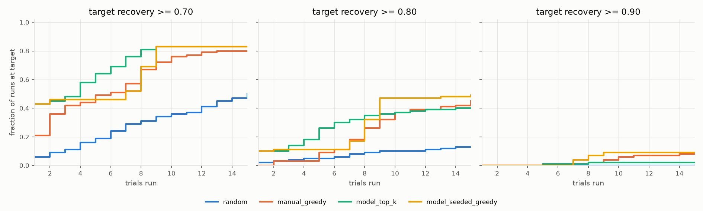

# Trial-efficiency simulation study

> **Synthetic data; demonstrates the methodology only; unrelated to any proprietary work.**
> Generated by `leach trial-study` from the invented simulator; regenerate to update.

## Setup

- 100 runs; each run draws a new, unseen feed batch from the simulator.
- Budget: 15 trials per strategy per run. Targets: [0.7, 0.8, 0.9].
- Success = first trial whose **noise-free** recovery meets the target; strategies only see noisy measurements.
- Strategies: `random`, `manual_greedy` (one-factor-at-a-time hill climb from the mid-point recipe), `model_top_k` (recommender's diverse top-k, open loop, no retraining), `model_seeded_greedy` (hill climb started at the model's top recipe).
- Medians count failures as 16 trials (a lower bound on their true cost).

## Results by target

| target | strategy | success_rate | success_rate_if_achievable | median_trials_censored | mean_trials_if_success |
|---|---|---|---|---|---|
| 0.70 | manual_greedy | 0.80 | 0.91 | 6.00 | 4.61 |
| 0.70 | model_seeded_greedy | 0.83 | 0.94 | 7.00 | 4.25 |
| 0.70 | model_top_k | 0.83 | 0.94 | 4.00 | 3.17 |
| 0.70 | random | 0.50 | 0.57 | 15.50 | 7.30 |
| 0.80 | manual_greedy | 0.45 | 0.73 | 16.00 | 8.27 |
| 0.80 | model_seeded_greedy | 0.49 | 0.79 | 16.00 | 6.88 |
| 0.80 | model_top_k | 0.40 | 0.65 | 16.00 | 4.90 |
| 0.80 | random | 0.13 | 0.21 | 16.00 | 6.69 |
| 0.90 | manual_greedy | 0.08 | 0.40 | 16.00 | 9.75 |
| 0.90 | model_seeded_greedy | 0.09 | 0.45 | 16.00 | 7.78 |
| 0.90 | model_top_k | 0.02 | 0.10 | 16.00 | 6.50 |
| 0.90 | random | 0.00 | 0.00 | 16.00 | - |

## Head-to-head vs manual_greedy (fraction of runs)

| comparison | target | a_fewer | tie | a_more |
|---|---|---|---|---|
| model_seeded_greedy vs manual_greedy | 0.70 | 0.35 | 0.40 | 0.25 |
| model_seeded_greedy vs manual_greedy | 0.80 | 0.31 | 0.55 | 0.14 |
| model_seeded_greedy vs manual_greedy | 0.90 | 0.07 | 0.89 | 0.04 |
| model_top_k vs manual_greedy | 0.70 | 0.46 | 0.31 | 0.23 |
| model_top_k vs manual_greedy | 0.80 | 0.33 | 0.49 | 0.18 |
| model_top_k vs manual_greedy | 0.90 | 0.02 | 0.91 | 0.07 |

## How good is the model's first recommendation?

- Mean predicted recovery of top-1 recipe: 0.749; mean true recovery of that recipe: 0.695.
- Mean optimism (predicted - true) at the recommended recipe: +0.053 (sd 0.061). Positive values are the expected optimiser's-curse bias.
- True recovery inside the reported interval for the top-1 recipe in 100% of runs (nominal 90%).
- Achievable (oracle) recovery across runs: mean 0.822, min 0.652; share of runs where each target is reachable: >= 0.70 88%, >= 0.80 62%, >= 0.90 20%.

## Where the model does not help

- target 0.80: model_top_k success rate 0.40 is below manual_greedy (0.45).
- target 0.80: the median run of every strategy failed within 15 trials, so median trial counts cannot separate them.
- target 0.90: model_top_k success rate 0.02 is below manual_greedy (0.08).
- target 0.90: the median run of every strategy failed within 15 trials, so median trial counts cannot separate them.
- target 0.70: 12 run(s) had a feed where the target is unreachable within the bounds (oracle); no strategy can succeed there.
- target 0.80: 38 run(s) had a feed where the target is unreachable within the bounds (oracle); no strategy can succeed there.
- target 0.90: 80 run(s) had a feed where the target is unreachable within the bounds (oracle); no strategy can succeed there.

